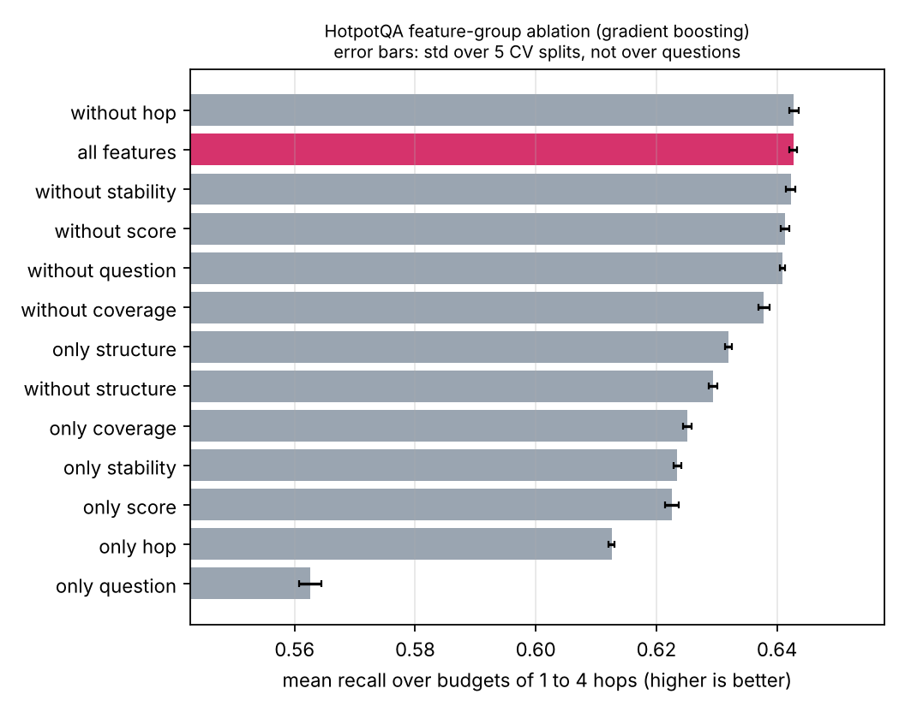

# Learning when to stop retrieving

A small study of one question in multi-hop retrieval: after each retrieval step, can a cheap
classifier tell whether the evidence collected so far is already sufficient, so the system can
stop instead of always running a fixed number of hops?

Short version of what I found:

- On HotpotQA, a gradient-boosting stopper beats "always run h hops" at the same average cost,
  by 2.4 to 6.0 percentage points of full-support recall (95% bootstrap intervals exclude 0).
- It is still far from an oracle that knows when to stop. At 2.6 hops it reaches 70.8% recall,
  while the oracle reaches 74.5% at 1.6 hops.
- The gain does not carry over cleanly. On 2WikiMultihopQA the in-domain result is a tie, and a
  model trained on HotpotQA does better than fixed hops there. On MuSiQue there is no gain.
- The main reason I found is that many questions never become sufficient with this retriever,
  and a "is it sufficient yet?" classifier keeps spending hops on them.

Everything here runs on a laptop CPU in about two minutes. No LLM and no GPU are involved.

## Why this question

Iterative retrieval systems have to decide when to stop. Fixed-depth retrieval wastes calls on
easy questions and cuts hard ones short. Asking an LLM after every hop works but costs an LLM
call per hop. I wanted to know how far cheap signals from the retrieval itself can go: scores,
how much of the question the evidence covers, whether retrieved passages point at each other.
Whether such a decision can be learned from feedback is one of the questions I am interested in
for my PhD applications, and this is a first, small, honest attempt at it.

## Setup

**Data.** The 1,000-question subsets of HotpotQA, 2WikiMultihopQA and MuSiQue that the HippoRAG
authors released, each with its own pooled passage corpus (about 9.8k, 6.1k and 11.7k passages).
`python -m stopret download` fetches them from
[OSU-NLP-Group/HippoRAG](https://github.com/OSU-NLP-Group/HippoRAG/tree/main/reproduce/dataset).
Searching a pooled corpus of this size is easier than searching all of Wikipedia, so absolute
recall numbers here are not comparable with full-corpus results.

**Retrieval.** BM25 (my own sparse implementation, checked against `rank_bm25` in the tests).
Hop 1 searches with the question. Every later hop searches with the question (repeated three
times) plus the text of the best new passage from the previous hop, and adds the 3 best passages
that were not retrieved before. After hop t the evidence holds up to 3t passages. Maximum 4 hops.
I compared a few query-rewriting variants and values of k on HotpotQA recall alone, before any
stopping model existed, and then kept this retriever unchanged for all three datasets.

**What "sufficient" means.** The evidence is sufficient after hop t if all gold supporting
passages are among the passages retrieved so far. This is a proxy for "a reader could answer the
question". It says nothing about whether a reader would actually get the answer right.

**Features** (20, in `stopret/features.py`, none of them look at the gold passages):

| group | what it captures |
|---|---|
| score | top BM25 score (normalised), gaps between the new passages, change since last hop, z-score against the 100 best passages |
| stability | share of this hop's top results that were already retrieved, mean pairwise overlap of the retrieved passages |
| coverage | idf-weighted share of question terms found in the evidence, how much the last hop added |
| structure | retrieved passages whose title is named in the question, passages that mention another retrieved passage's title |
| question | length, yes/no form, comparison words, number of capitalised words |
| hop | the hop index |

**Policies.** A policy turns a "stop score" per question and hop into a stopping hop: stop at
the first hop whose score reaches a threshold tau, otherwise at hop 4. Sweeping tau gives a
cost/quality curve for each policy.

- *fixed*: always run h hops (h = 1 to 4)
- *heuristics*: stop when question coverage, or the top-score margin, passes a threshold
- *learned*: logistic regression or gradient boosting predicting "sufficient now" (5-fold CV,
  split by question, so a question never appears in both training and test)
- *learned + give-up* (added later, see below): a second gradient-boosting model predicts
  "will this question ever become sufficient within 4 hops?", and the policy also stops when that
  probability drops below rho = 0.1
- *oracle*: stops at the first sufficient hop (uses the gold passages, so it is only a bound)

**Metrics.** Cost is the average number of hops. Quality is full-support recall: the share of
questions whose evidence is sufficient at the hop where the policy stops. Two operating points can
be mixed by flipping a coin per question, so I compare policies through the upper convex hull of
their (cost, recall) points, the fixed-hop baseline included. For individual thresholds I report a
paired bootstrap (1,000 resamples of questions) of the recall difference to the fixed-hop baseline
at the same average cost.

## Results

All numbers are produced by `python -m stopret run`; the full output is in
`results/results_tables.md` and `results/metrics.json`.

### HotpotQA


Recall (%) at a given average number of hops, 5-fold CV:

| Policy | 1.5 hops | 2.0 | 2.5 | 3.0 | mean over 1 to 4 hops |
|---|---:|---:|---:|---:|---:|
| Fixed number of hops | 48.4 | 60.3 | 64.1 | 67.9 | 61.2 |
| Heuristic: question coverage | 46.2 | 54.8 | 61.5 | 66.1 | 57.8 |
| Heuristic: top-score margin | 44.2 | 51.5 | 57.5 | 63.1 | 56.8 |
| Learned: logistic regression | 48.4 | 60.1 | 68.0 | 72.0 | 63.1 |
| Learned: gradient boosting | 50.7 | 62.7 | 70.3 | 72.4 | 64.4 |

Oracle: 74.5% recall at 1.59 average hops. Without any stopping, the retriever reaches 36.4%,
60.3%, 67.9% and 74.5% after 1 to 4 hops.

Gradient boosting at fixed thresholds against the fixed-hop baseline at the same cost:

| tau | avg hops | recall % | fixed hops, same cost | difference | 95% CI |
|---:|---:|---:|---:|---:|---|
| 0.3 | 1.92 | 61.1 | 58.5 | +2.6 pp | [+0.7, +4.8] |
| 0.5 | 2.20 | 66.0 | 61.8 | +4.2 pp | [+2.3, +6.0] |
| 0.7 | 2.59 | 70.8 | 64.8 | +6.0 pp | [+4.4, +7.6] |
| 0.9 | 3.54 | 73.9 | 71.5 | +2.4 pp | [+1.6, +3.1] |

The classifier's ROC-AUC for "sufficient now" is 0.881 for gradient boosting and 0.821 for
logistic regression (mean over 5 different CV splits; spread about 0.002).

Two things I take from this. Single-signal threshold rules are worse than just using a fixed
number of hops, so the useful part is combining signals. And the gap to the oracle is large:
most of what an ideal stopper would save is not captured by these features.

### Which features matter



Dropping the *structure* features (title mentions and links between passages) costs the most
(AUC 0.881 to 0.794), then *coverage* (to 0.841). Dropping *stability* or *hop* changes nothing
measurable. I had expected the stability features to matter more. The error bars only show
variation across CV splits, not uncertainty from the choice of questions, so differences below
about half a point in this figure should not be read as real. The "all features" bar (64.3) is the
mean over five CV seeds, which is why it differs slightly from the 64.4 in the table above (seed 0).

### Other datasets


Solid lines are trained on the dataset itself (CV), dotted lines are trained on HotpotQA only.

| Dataset | recall after hop 1 / 2 / 3 / 4 | oracle |
|---|---|---|
| 2WikiMultihopQA | 26.5 / 46.6 / 50.4 / 53.1 | 53.1% at 1.36 hops |
| MuSiQue | 6.2 / 13.6 / 16.7 / 18.2 | 18.2% at 1.18 hops |

Difference to the fixed-hop baseline at the same cost (percentage points, 95% CI), gradient boosting:

| Dataset and training | tau = 0.3 | 0.5 | 0.7 | 0.9 |
|---|---|---|---|---|
| 2Wiki, trained on 2Wiki | -2.9 [-4.4, -1.6] | -0.3 [-1.4, +0.8] | +0.8 [0.0, +1.5] | +0.3 [+0.2, +0.4] |
| 2Wiki, trained on HotpotQA | +3.1 [+1.6, +4.8] | +2.2 [+0.3, +3.8] | +2.3 [+1.0, +3.6] | +1.2 [+0.1, +2.3] |
| MuSiQue, trained on MuSiQue | -0.4 [-1.0, +0.2] | 0.0 [-0.2, +0.1] | 0.0 | 0.0 |
| MuSiQue, trained on HotpotQA | -1.9 [-3.0, -0.9] | -1.9 [-2.9, -0.9] | -0.9 [-1.7, -0.1] | -0.1 [-0.5, +0.2] |

So the HotpotQA result does not hold up as a general claim. On 2Wiki a model trained elsewhere
beat one trained in-domain, which I cannot fully explain; one possibility is that the in-domain
model learns the many 4-passage questions as a pattern that hurts at low thresholds, but I did
not test that. On MuSiQue there is simply little to decide, because 82% of the questions never
become sufficient.

### The "never sufficient" problem, and the give-up rule

`scripts/hopeless_questions.py` (output in `results/hopeless_questions.txt`) shows where hops
get wasted. In 2Wiki, the 235 questions with four gold passages are almost never sufficient with
3 new passages per hop (3.4%), and the learned policy at tau = 0.5 spends 3.81 hops on them on
average, where an oracle would stop at hop 1. Across the 469 never-sufficient 2Wiki questions it
averages 3.57 hops. On HotpotQA the 255 never-sufficient questions get 3.09 hops.

A "sufficient now?" classifier has no way to say "stop, this is hopeless". After seeing this, I
added the second classifier and the give-up threshold rho described above. **This was added after
looking at the first results, not planned beforehand**, and I fixed rho = 0.1 before running it.
What it did:

- HotpotQA: no change at rho = 0.1 (the rule rarely fires there).
- 2Wiki: small and mixed. -2.3 to +1.2 pp against fixed hops, depending on tau.
- MuSiQue: +0.4 to +0.6 pp with intervals that include 0.
- rho is sensitive to how often questions are sufficient at all. On MuSiQue, rho = 0.3 makes the
  policy give up almost everywhere (mean recall 9.6% against 14.2% for fixed hops). The sensitivity
  table is in `results/results_tables.md`.

I would not claim the give-up rule works. It is a diagnosis with a partial fix.

## Limitations

- BM25 only. A dense retriever would change the score features and probably the recall curves.
  I could not download embedding models where I built this, so I left it out.
- Pooled corpora of 6k to 12k passages, and 1,000 questions per dataset. Confidence intervals
  reflect that, but the setting is easier than open-domain retrieval.
- "Sufficient" means the gold passages were retrieved. No reader model checks the answer.
- The original idea also had an LLM-judge stopping baseline and answer-stability as a feature.
  Neither is in the results. The stability features here measure how stable the *retrieved set* is,
  not the answer. The LLM-judge code exists (`stopret/llm_judge.py`) and is tested against a mock
  Ollama server, but I have not run it with a real model, so there is no number for it yet.
- Hyperparameters of the classifiers are fixed defaults, not tuned. Thresholds are swept and shown
  as curves; the CV predictions are out-of-fold, but I choose which thresholds to discuss after
  seeing the curves.
- Only the "will this evidence be sufficient" question is learned. A policy that predicts how much
  one more hop would help is the obvious next step and could handle the hopeless cases directly.

## Running it

```bash
pip install -r requirements-dev.txt
python -m stopret download      # about 43 MB from GitHub
python -m stopret run           # trajectories, CV, transfer, ablation, figures (about 2 min)
python -m pytest                # 15 tests
```

`python -m stopret report` redraws the figures and tables from `results/metrics.json` without
recomputing. Results are deterministic: running everything again gave identical metrics.

Optional LLM-judge baseline (needs [Ollama](https://ollama.com) running locally):

```bash
python -m stopret judge --model llama3.2:3b --n 200
```

This judges the first 200 HotpotQA questions after every hop and writes
`results/llm_judge_<model>.json`, comparing the judge with the fixed and learned policies at
the same cost on the same questions.

## Layout

```
stopret/
  data.py          load the three datasets, map gold passages to corpus ids
  bm25.py          sparse BM25
  trajectory.py    iterative retrieval, one result per hop
  features.py      the 20 features and the labels
  models.py        logistic regression / gradient boosting, question-grouped CV
  policies.py      stopping rules (fixed, threshold, give-up, oracle)
  evaluation.py    cost/recall, convex hull, paired bootstrap
  experiments.py   every experiment in this README
  plots.py, report.py, cli.py
  llm_judge.py     optional Ollama baseline
scripts/hopeless_questions.py
tests/
results/           metrics.json, results_tables.md, figures, per-hop feature tables (CSV)
```

## Sources

- HotpotQA: Yang et al., 2018. 2WikiMultihopQA: Ho et al., 2020. MuSiQue: Trivedi et al., 2022.
- The 1,000-question subsets and pooled corpora come from the HippoRAG repository
  (Gutierrez et al., 2024). The datasets keep their original licences; check each dataset's
  page before redistributing the data. The raw files are not included in this repository.
- BM25 follows the Okapi formulation as implemented in the `rank_bm25` package.
