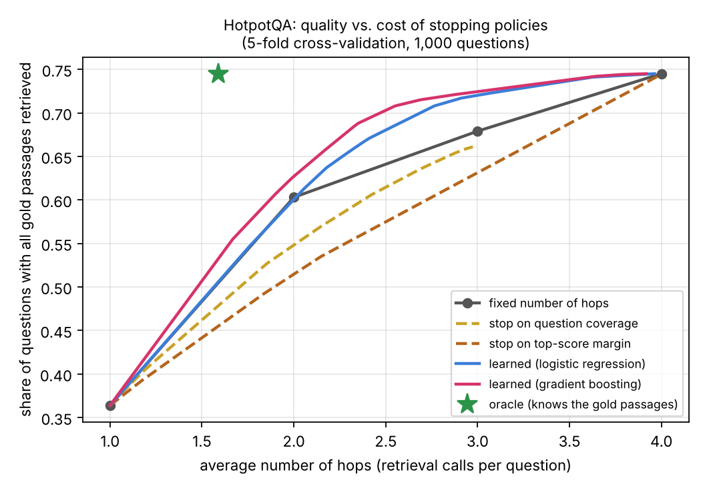
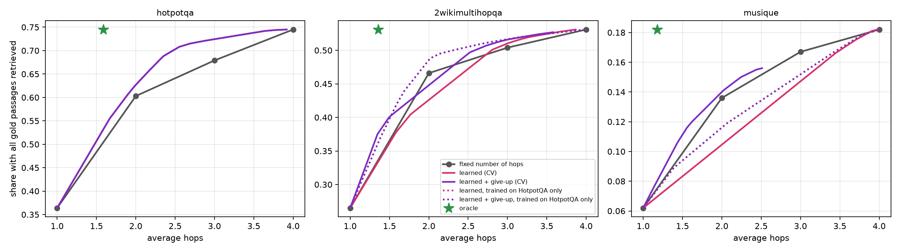

# Learning when to stop retrieving

A small study of one question in multi-hop retrieval: after each retrieval step, can a cheap
classifier tell whether the evidence collected so far is already sufficient, so the system can
stop instead of always running a fixed number of hops?

Short version of what I found:

- On HotpotQA, a gradient-boosting stopper beats "always run h hops" at the same average cost,
  by 2.4 to 6.0 percentage points of full-support recall (95% bootstrap intervals exclude 0).
- It is still far from an oracle that knows when to stop. At 2.6 hops it reaches 70.8% recall,
  while the oracle reaches 74.5% at 1.6 hops.
- The gain does not carry over cleanly. On 2WikiMultihopQA the in-domain result is a tie, and a
  model trained on HotpotQA does better than fixed hops there. On MuSiQue there is no gain.
- The main reason I found is that many questions never become sufficient with this retriever,
  and a "is it sufficient yet?" classifier keeps spending hops on them.

Everything here runs on a laptop CPU in about two minutes. No LLM and no GPU are involved.

## Why this question

Iterative retrieval systems have to decide when to stop. Fixed-depth retrieval wastes calls on
easy questions and cuts hard ones short. Asking an LLM after every hop works but costs an LLM
call per hop. I wanted to know how far cheap signals from the retrieval itself can go: scores,
how much of the question the evidence covers, whether retrieved passages point at each other.
Whether such a decision can be learned from feedback is one of the questions I am interested in
for my PhD applications, and this is a first, small, honest attempt at it.

## Setup

**Data.** The 1,000-question subsets of HotpotQA, 2WikiMultihopQA and MuSiQue that the HippoRAG
authors released, each with its own pooled passage corpus (about 9.8k, 6.1k and 11.7k passages).
`python -m stopret download` fetches the six files (about 43 MB) from
[OSU-NLP-Group/HippoRAG](https://github.com/OSU-NLP-Group/HippoRAG/tree/main/reproduce/dataset),
pinned to one commit and checked against SHA-256 hashes, so the data behind the numbers cannot
change silently and an interrupted download cannot leave a broken file behind.
Searching a pooled corpus of this size is easier than searching all of Wikipedia, so absolute
recall numbers here are not comparable with full-corpus results.

**Retrieval.** BM25 (my own sparse implementation, checked against `rank_bm25` in the tests).
Hop 1 searches with the question. Every later hop searches with the question (repeated three
times) plus the text of the best new passage from the previous hop, and adds the 3 best passages
that were not retrieved before. After hop t the evidence holds up to 3t passages. Maximum 4 hops.
I compared a few query-rewriting variants and values of k on HotpotQA recall alone, before any
stopping model existed, and then kept this retriever unchanged for all three datasets.

**What "sufficient" means.** The evidence is sufficient after hop t if all gold supporting
passages are among the passages retrieved so far. This is a proxy for "a reader could answer the
question". It says nothing about whether a reader would actually get the answer right.

**Features** (20, in `stopret/features.py`, none of them look at the gold passages):

| group | what it captures |
|---|---|
| score | top BM25 score (normalised), gaps between the new passages, change since last hop, z-score against the 100 best passages |
| stability | share of this hop's top results that were already retrieved, mean pairwise overlap of the retrieved passages |
| coverage | idf-weighted share of question terms found in the evidence, how much the last hop added |
| structure | retrieved passages whose title is named in the question, passages that mention another retrieved passage's title |
| question | length, yes/no form, comparison words, number of capitalised words |
| hop | the hop index |

**Policies.** A policy turns a "stop score" per question and hop into a stopping hop: stop at
the first hop whose score reaches a threshold tau, otherwise at hop 4. Sweeping tau gives a
cost/quality curve for each policy.

- *fixed*: always run h hops (h = 1 to 4)
- *heuristics*: stop when question coverage, or the top-score margin, passes a threshold
- *learned*: logistic regression or gradient boosting predicting "sufficient now" (5-fold CV,
  split by question, so a question never appears in both training and test)
- *learned + give-up* (added later, see below): a second gradient-boosting model predicts
  "will this question ever become sufficient within 4 hops?", and the policy also stops when that
  probability drops below rho = 0.1
- *oracle*: stops at the first sufficient hop (uses the gold passages, so it is only a bound)

**Metrics.** Cost is the average number of hops. Quality is full-support recall: the share of
questions whose evidence is sufficient at the hop where the policy stops. Two operating points can
be mixed by flipping a coin per question, so I compare policies through the upper convex hull of
their (cost, recall) points, the fixed-hop baseline included. For individual thresholds I report a
paired bootstrap (1,000 resamples of questions) of the recall difference to the fixed-hop baseline
at the same average cost.

## Results

All numbers are produced by `python -m stopret run`; the full output is in
`results/results_tables.md` and `results/metrics.json`.

### HotpotQA



Recall (%) at a given average number of hops, 5-fold CV:

| Policy | 1.5 hops | 2.0 | 2.5 | 3.0 | mean over 1 to 4 hops |
|---|---:|---:|---:|---:|---:|
| Fixed number of hops | 48.4 | 60.3 | 64.1 | 67.9 | 61.2 |
| Heuristic: question coverage | 46.2 | 54.8 | 61.5 | 66.1 | 57.8 |
| Heuristic: top-score margin | 44.2 | 51.5 | 57.5 | 63.1 | 56.8 |
| Learned: logistic regression | 48.4 | 60.1 | 68.0 | 72.0 | 63.1 |
| Learned: gradient boosting | 50.7 | 62.7 | 70.3 | 72.4 | 64.4 |

Oracle: 74.5% recall at 1.59 average hops. Without any stopping, the retriever reaches 36.4%,
60.3%, 67.9% and 74.5% after 1 to 4 hops.

Gradient boosting at fixed thresholds against the fixed-hop baseline at the same cost:

| tau | avg hops | recall % | fixed hops, same cost | difference | 95% CI |
|---:|---:|---:|---:|---:|---|
| 0.3 | 1.92 | 61.1 | 58.5 | +2.6 pp | [+0.7, +4.8] |
| 0.5 | 2.20 | 66.0 | 61.8 | +4.2 pp | [+2.3, +6.0] |
| 0.7 | 2.59 | 70.8 | 64.8 | +6.0 pp | [+4.4, +7.6] |
| 0.9 | 3.54 | 73.9 | 71.5 | +2.4 pp | [+1.6, +3.1] |

The classifier's ROC-AUC for "sufficient now" is 0.881 for gradient boosting and 0.821 for
logistic regression (mean over 5 different CV splits; spread about 0.002).

Two things I take from this. Single-signal threshold rules are worse than just using a fixed
number of hops, so the useful part is combining signals. And the gap to the oracle is large:
most of what an ideal stopper would save is not captured by these features.

### Which features matter


Dropping the *structure* features (title mentions and links between passages) costs the most
(AUC 0.881 to 0.794), then *coverage* (to 0.841). Dropping *stability* or *hop* changes nothing
measurable. I had expected the stability features to matter more. The error bars only show
variation across CV splits, not uncertainty from the choice of questions, so differences below
about half a point in this figure should not be read as real. The "all features" bar (64.3) is the
mean over five CV seeds, which is why it differs slightly from the 64.4 in the table above (seed 0).

### Other datasets



Solid lines are trained on the dataset itself (CV), dotted lines are trained on HotpotQA only.

| Dataset | recall after hop 1 / 2 / 3 / 4 | oracle |
|---|---|---|
| 2WikiMultihopQA | 26.5 / 46.6 / 50.4 / 53.1 | 53.1% at 1.36 hops |
| MuSiQue | 6.2 / 13.6 / 16.7 / 18.2 | 18.2% at 1.18 hops |

Difference to the fixed-hop baseline at the same cost (percentage points, 95% CI), gradient boosting:

| Dataset and training | tau = 0.3 | 0.5 | 0.7 | 0.9 |
|---|---|---|---|---|
| 2Wiki, trained on 2Wiki | -2.9 [-4.4, -1.6] | -0.3 [-1.4, +0.8] | +0.8 [0.0, +1.5] | +0.3 [+0.2, +0.4] |
| 2Wiki, trained on HotpotQA | +3.1 [+1.6, +4.8] | +2.2 [+0.3, +3.8] | +2.3 [+1.0, +3.6] | +1.2 [+0.1, +2.3] |
| MuSiQue, trained on MuSiQue | -0.4 [-1.0, +0.2] | 0.0 [-0.2, +0.1] | 0.0 | 0.0 |
| MuSiQue, trained on HotpotQA | -1.9 [-3.0, -0.9] | -1.9 [-2.9, -0.9] | -0.9 [-1.7, -0.1] | -0.1 [-0.5, +0.2] |

So the HotpotQA result does not hold up as a general claim. On 2Wiki a model trained elsewhere
beat one trained in-domain, which I cannot fully explain; one possibility is that the in-domain
model learns the many 4-passage questions as a pattern that hurts at low thresholds, but I did
not test that. On MuSiQue there is simply little to decide, because 82% of the questions never
become sufficient.

### The "never sufficient" problem, and the give-up rule

`scripts/hopeless_questions.py` (output in `results/hopeless_questions.txt`) shows where hops
get wasted. In 2Wiki, the 235 questions with four gold passages are almost never sufficient with
3 new passages per hop (3.4%), and the learned policy at tau = 0.5 spends 3.81 hops on them on
average, where an oracle would stop at hop 1. Across the 469 never-sufficient 2Wiki questions it
averages 3.57 hops. On HotpotQA the 255 never-sufficient questions get 3.09 hops.

A "sufficient now?" classifier has no way to say "stop, this is hopeless". After seeing this, I
added the second classifier and the give-up threshold rho described above. **This was added after
looking at the first results, not planned beforehand**, and I fixed rho = 0.1 before running it.
What it did:

- HotpotQA: no change at rho = 0.1 (the rule rarely fires there).
- 2Wiki: small and mixed. -2.3 to +1.2 pp against fixed hops, depending on tau.
- MuSiQue: +0.4 to +0.6 pp with intervals that include 0.
- rho is sensitive to how often questions are sufficient at all. On MuSiQue, rho = 0.3 makes the
  policy give up almost everywhere (mean recall 9.6% against 14.2% for fixed hops). The sensitivity
  table is in `results/results_tables.md`.

I would not claim the give-up rule works. It is a diagnosis with a partial fix.

## Limitations

- BM25 only. A dense retriever would change the score features and probably the recall curves.
  I could not download embedding models where I built this, so I left it out.
- Pooled corpora of 6k to 12k passages, and 1,000 questions per dataset. Confidence intervals
  reflect that, but the setting is easier than open-domain retrieval.
- "Sufficient" means the gold passages were retrieved. No reader model checks the answer.
- The original idea also had an LLM-judge stopping baseline and answer-stability as a feature.
  Neither is in the results. The stability features here measure how stable the *retrieved set* is,
  not the answer. The LLM-judge code exists (`stopret/llm_judge.py`; Ollama, free hosted open-model
  APIs, any OpenAI-compatible server) and is tested against mock servers, but I have not run it
  with a real model, so there is no number for it yet. See "LLM-judge baseline" below.
- Hyperparameters of the classifiers are fixed defaults, not tuned. Thresholds are swept and shown
  as curves; the CV predictions are out-of-fold, but I choose which thresholds to discuss after
  seeing the curves.
- Only the "will this evidence be sufficient" question is learned. A policy that predicts how much
  one more hop would help is the obvious next step and could handle the hopeless cases directly.

## Running it

Python 3.10 or newer (developed and tested on 3.12).

```bash
pip install -r requirements-dev.txt
python -m stopret download      # 6 files, about 43 MB, SHA-256 verified
python -m stopret run           # trajectories, CV, transfer, ablation, figures (about 2 min, 1 CPU core)
python -m pytest                # 71 tests (plain `pytest` works too)
```

`python -m stopret report` redraws the figures and tables from `results/metrics.json` without
recomputing. Running `download` again later re-verifies the files.

**Reproducibility.** The numbers in this README come from the exact library versions in
`requirements-lock.txt`; running everything twice there gave identical metrics. I also ran the full
test suite and the whole pipeline with the oldest versions that `requirements.txt` allows
(numpy 1.26, scipy 1.11, pandas 2.1, scikit-learn 1.4, matplotlib 3.8). The retrieval trajectories
and features come out identical (differences around 1e-15), logistic-regression results are
identical, and gradient-boosting results move slightly because scikit-learn changed between
versions: AUC by at most 0.1 points, recall at a given budget by at most 0.2 points, and the
differences to the fixed-hop baseline in the tables by at most 0.3 points. No conclusion changes.

## LLM-judge baseline (optional, not run yet)

The comparison I wanted from the start: after every hop, ask an LLM "is this evidence enough to
answer the question?" and stop at the first YES. It costs one LLM request per hop, which is exactly
what the learned classifier avoids, so it is the natural thing to compare against. The judge sees
the question and all passages retrieved so far, and must answer YES or NO. Questions that already
stopped are not sent to the LLM again, so the request count is what a real deployment would pay.

I could not run any of this where I built the project (no access to these APIs), so there is no
number yet. What is tested, against mock servers, is everything around the model call: request
format for each provider, answer parsing, retries, pacing, caching, error messages.

### Step 1: see what it will cost before spending any quota

```bash
python -m stopret judge --dry-run --n 100 --tokens-per-minute 8000 --tpd 200000 --rpm 30 --rpd 1000
```

No API call is made. Put in the limits from your own provider console. For the first 100 HotpotQA
questions the worst case (the judge says NO after every hop, so all hops are sent) is:

| | |
|---|---|
| requests | 400 |
| prompt tokens (estimate, 4 characters per token) | about 430,000 (plus up to `--max-tokens` per reply) |
| prompt size by hop | about 420, 840, 1,310 and 1,750 tokens |
| with Groq's sample free limits (8k tokens/min, 200k tokens/day) | at least 54 minutes, and about 2.2 days |

In practice usage is lower because the judge stops at its first YES. The point is that on free
tiers the limit that hurts is usually *tokens per minute and per day*, not requests per minute.

### Step 2: pick a provider

All of these host open-weight models behind an OpenAI-compatible API. Limits below are what I could
read from the providers' own documentation and from third-party trackers in autumn 2026. Free tiers
change often, so treat the numbers as a starting point and check your console (and your own
`--dry-run`).

| Provider (`--backend`) | Free-tier limits as published | What it means for n = 100 |
|---|---|---|
| `mistral` | Mistral's help centre: 1 request/second, 500,000 tokens/minute, 1 billion tokens/month | the only one where it finishes in minutes (400 requests at 1 per second is about 7 minutes) |
| `cerebras` | about 1 million tokens/day reported by several sources; sources disagree on the requests-per-minute limit (5 vs 30) and on whether a card is needed | fits in a day if the daily limit holds; very fast responses |
| `groq` | docs list sample free limits of 30 requests/min, 1,000 requests/day, 8,000 tokens/min, 200,000 tokens/day for gpt-oss and a Qwen model | fastest responses, but the token limits mean roughly 40 questions per day; n = 100 takes about 3 days (the cache lets you resume) |
| `openrouter` | free models (ids ending in `:free`); community lists report about 20 requests/min and 200 requests/day | about 50 questions per day |
| `ollama` | none (runs on your machine) | no quota, but slow on a CPU; fine for a 20-question smoke test |

**My ranking for this workload is based only on those published limits, not on running anything:**
Mistral first (largest quota, provided there is a model with open weights on the free tier that
you like), then Cerebras, then Groq, then OpenRouter. Groq is not slower per request. It simply runs
out of tokens first. Whatever you choose, run `--n 20` first to check that answers parse and the
numbers look sane, then the full run.

**Which model.** The judge has to read 3 to 12 short passages and decide whether they are enough.
I would expect large instruct models (gpt-oss-120b class and up) to be more reliable than 8B-class
ones, and I would run one small and one large model on the same `--n` to show how much the baseline
depends on the model. I have not measured this. Use the exact model id shown in the provider's
console; ids change and old ones are retired.

### Step 3: run it

```bash
export MISTRAL_API_KEY=...            # keys come from each provider's console; never commit them
python -m stopret judge --backend mistral --model <open-weight model id> --n 100 \
    --rpm 50 --tokens-per-minute 400000

# gpt-oss models are reasoning models: lower the effort and leave room for the answer
export CEREBRAS_API_KEY=...
python -m stopret judge --backend cerebras --model gpt-oss-120b --n 100 \
    --extra-body '{"reasoning_effort": "low"}' --max-tokens 512 --rpm 30

export GROQ_API_KEY=...
python -m stopret judge --backend groq --model openai/gpt-oss-120b --n 40 \
    --extra-body '{"reasoning_effort": "low"}' --max-tokens 512 --rpm 30 --tokens-per-minute 8000

export OPENROUTER_API_KEY=...         # OpenRouter takes the reasoning option in a different shape
python -m stopret judge --backend openrouter --model <model id>:free --n 50 \
    --extra-body '{"reasoning": {"effort": "low"}}' --max-tokens 512 --rpm 20

# any other OpenAI-compatible server
python -m stopret judge --backend openai-compatible --host https://example.com/v1 \
    --api-key-env MY_KEY --model <id>

# a model on your own machine
python -m stopret judge --backend ollama --model llama3.2:3b --n 20

python -m stopret report              # adds an "LLM-judge" table to results/results_tables.md
```

| Option | What it does |
|---|---|
| `--n` | first n HotpotQA questions. Use the same n for every model you compare |
| `--rpm`, `--min-interval` | spacing between requests (`--rpm 30` means one every 2 seconds) |
| `--tokens-per-minute` | paces requests so the *estimated* tokens in any 60 seconds stay under your limit |
| `--max-tokens` | output limit (default 16). Reasoning models need more, for example 512 |
| `--extra-body` | JSON merged into the request, for provider-specific options such as the reasoning effort |
| `--host`, `--api-key-env` | server URL and the name of the key's environment variable (generic backend) |
| `--dry-run`, `--tpd`, `--rpd` | estimate only, see Step 1 |

What the client does for you: it retries 429 and 5xx answers using the wait the server states, and
stops with a clear message (instead of sleeping for hours) when the server asks for a long wait,
for example when a daily limit is used up. Every answer is cached on disk under a hash of the full
prompt and all settings, so running the same command again, tomorrow if need be, resumes where it
stopped and never reuses an answer given under different settings. If the model returns an empty
answer because a reasoning model spent its whole output budget thinking, the run stops with advice
on how to fix it instead of counting it as NO. If a provider refuses a prompt (for example a content
filter), that hop counts as NO and the refusals are reported.

The output (`results/llm_judge_<backend>_<model>.json`) has the judge's average hops and recall on
the first n HotpotQA questions, the difference to the fixed-hop baseline at the same cost with a
bootstrap interval, the learned classifier at the same cost on the same questions, the oracle, and
how many requests were sent. With n = 100 the intervals will be wide.

**Gemini** (`--backend gemini`, key in `GEMINI_API_KEY`) is also supported, including a `--thinking`
setting for models that think by default. Gemini models are proprietary, so this backend is not part
of the open-source setup; I kept it as an optional extra.

### If something goes wrong

| What you see | What it means and what to do |
|---|---|
| `stopped: ... Progress is cached; run the same command again later` | a rate limit was hit (often the daily token limit). Nothing is lost: run the same command later and it resumes from the cache |
| `error: set the ..._API_KEY environment variable` | the key is not set in this terminal; `export` it again (a new terminal does not inherit it) |
| `HTTP 401` | wrong or expired key |
| `HTTP 400` or `404` mentioning the model | the model id is wrong or retired; copy it from the provider's console. A 400 about an option usually means `--extra-body` or `--thinking` does not suit that model |
| `the model returned an empty answer ... only reasoning` | a reasoning model used its whole output budget on thinking: raise `--max-tokens` (for example 512) and lower the effort with `--extra-body` |
| a run is slower than expected | pacing is working as intended: lower `--rpm` / `--tokens-per-minute` only if your limits allow it, or use a provider with a larger quota |
| `SHA-256 mismatch` or `verification failed` | a dataset file is corrupt or the source changed; run `python -m stopret download --force` |
| `FileNotFoundError ... python -m stopret download` | the data has not been downloaded yet |

## Open-source stack and licences

Everything needed to reproduce the main results is open source or openly licensed, and none of it
needs an API key. The LLM-judge baseline is the only part that calls a model.

| Part | What | Licence |
|---|---|---|
| This code | the `stopret` package, tests, scripts | MIT (see `LICENSE`; change it if you prefer another) |
| Libraries | numpy, scipy, pandas, scikit-learn | BSD-3-Clause |
| | matplotlib | Matplotlib licence (BSD-style, PSF-based) |
| | pytest (tests), rank_bm25 (tests only) | MIT, Apache-2.0 |
| Retriever | BM25, implemented in this repository | no model or API needed |
| Data | HotpotQA | CC BY-SA 4.0 for the data (its README) |
| | 2WikiMultihopQA | the repository's licence file is Apache-2.0; check the dataset terms |
| | MuSiQue | CC BY 4.0 (its README) |
| | the 1,000-question subsets | taken from the HippoRAG repository (MIT) |
| LLM judge (optional) | open-weight models on free hosted APIs, or Ollama | depends on the model, see below |

The raw data is downloaded, not stored in this repository. The CSVs in `results/` contain only
numeric features and question ids.

"Open weights" is not the same as an open-source licence. For the optional judge: the gpt-oss
models are released under Apache 2.0 (check the model card of the exact model you use), Llama
models come under Meta's own community licence, which is not an OSI open-source licence, and Gemini
has no downloadable weights at all. If you want to say the whole project is open source, pick a
model with an Apache-2.0 or similar licence, and remember that a hosted free tier still has its own
terms of service.

## Layout

```
stopret/
  data.py          dataset download (pinned commit, SHA-256 checks), loading, gold-passage mapping
  bm25.py          sparse BM25
  trajectory.py    iterative retrieval, one result per hop
  features.py      the 20 features and the labels
  models.py        logistic regression / gradient boosting, question-grouped CV
  policies.py      stopping rules (fixed, threshold, give-up, oracle)
  evaluation.py    cost/recall, convex hull, paired bootstrap
  experiments.py   every experiment in this README, the LLM-judge runner and the dry-run estimate
  plots.py, report.py, cli.py
  llm_judge.py     optional LLM-judge baseline: Ollama, free hosted APIs, generic OpenAI-compatible
                   servers, Gemini; pacing, retries, cache
scripts/hopeless_questions.py
tests/             71 tests (BM25 vs rank_bm25, pipeline invariants, data integrity, mock-server tests)
results/           metrics.json, results_tables.md, figures, per-hop feature tables (CSV)
requirements.txt, requirements-dev.txt, requirements-lock.txt, pytest.ini, Makefile, LICENSE
```

## Sources

- HotpotQA: Yang et al., 2018. 2WikiMultihopQA: Ho et al., 2020. MuSiQue: Trivedi et al., 2022.
- The 1,000-question subsets and pooled corpora come from the HippoRAG repository
  (Gutierrez et al., 2024), pinned to commit `d5c8329`. The datasets keep their original licences
  (see the table above). The raw files are not included in this repository.
- BM25 follows the Okapi formulation as implemented in the `rank_bm25` package.
- Provider limits in the LLM-judge section: Groq's rate-limit documentation, Mistral's help centre,
  Cerebras documentation and third-party trackers, read in autumn 2026. They change; check your
  own console.
